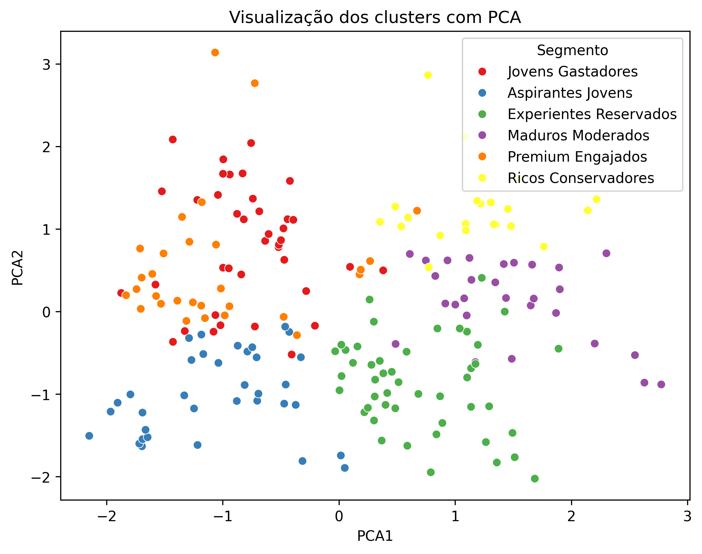

# Segmentação de clientes com K-Means

Estudo exploratório de segmentação de 200 clientes usando perfil demográfico, renda anual e score de gastos. O objetivo é formular hipóteses para ações de marketing a partir de grupos com características semelhantes.

O projeto apresenta seis clusters e visualizações de seus perfis. Não houve execução de campanhas nem medição de aumento de vendas, engajamento ou retenção.

## Dados

A base está em [data/Mall_Customers.csv](data/Mall_Customers.csv). Cada linha representa um cliente, com as colunas:

| Coluna | Uso |
| --- | --- |
| `CustomerID` | Identificador, excluído da clusterização |
| `Genre` | Categoria demográfica, codificada como Male=1 e Female=0 |
| `Age` | Idade |
| `Annual Income (k$)` | Renda anual em milhares de dólares |
| `Spending Score (1-100)` | Score de gastos |

A procedência externa e a licença da versão do arquivo precisam ser documentadas. A análise é demonstrativa e não caracteriza uma carteira real de clientes do autor.

## Método

O [notebook](notebooks/mall_customers_clustering.ipynb) contém:

1. Inspeção da base e análise de distribuição das variáveis.
2. Codificação de `Genre` e padronização dos quatro atributos com `StandardScaler`.
3. Método do cotovelo para k de 1 a 10 e comparação do silhouette para k de 2 a 6.
4. Ajuste final de K-Means com **6 clusters** e `random_state=42`.
5. Perfil médio por cluster, rótulos interpretativos e projeção em duas dimensões com PCA.

O PCA é usado na visualização; o K-Means é ajustado nos quatro atributos padronizados.

## Resultados registrados

As saídas salvas no notebook apresentam:

| k | Silhouette |
| ---: | ---: |
| 2 | 0,2776 |
| 3 | 0,2576 |
| 4 | 0,2901 |
| 5 | 0,2719 |
| 6 | 0,3348 |

O melhor silhouette entre os valores comparados é **0,3348 para k=6**. Isso não demonstra que seis seja a quantidade ideal em outros dados ou que os grupos tenham utilidade comercial validada.

| Cluster | Idade média | Renda anual média (k$) | Score médio de gastos |
| ---: | ---: | ---: | ---: |
| 0 | 57,21 | 46,79 | 38,71 |
| 1 | 39,00 | 88,33 | 14,43 |
| 2 | 28,41 | 58,23 | 70,72 |
| 3 | 33,21 | 91,03 | 72,14 |
| 4 | 25,89 | 41,28 | 57,94 |
| 5 | 49,91 | 54,26 | 36,53 |

Esses valores foram transcritos das saídas versionadas, sem nova execução nesta revisão. Os identificadores de cluster são arbitrários e podem mudar entre ajustes.

### Aplicação de negócio proposta

Os perfis podem orientar hipóteses de campanhas: por exemplo, investigar uma oferta para o grupo com renda maior e score de gastos menor. Para decidir uma ação, ainda é necessário testar estabilidade dos grupos, custos e resultados por meio de um experimento. Score de gastos não mede diretamente engajamento ou propensão de resposta a uma campanha.

### Visualização



## Executar localmente

```bash
git clone https://github.com/Gustavocorreard/mall-customers-clustering.git
cd mall-customers-clustering
python -m venv .venv
```

Ative o ambiente:

```powershell
# Windows PowerShell
.venv\Scripts\Activate.ps1
```

```bash
# macOS ou Linux
source .venv/bin/activate
```

Instale as bibliotecas e abra o notebook:

```bash
python -m pip install -r requirements.txt
python -m pip install jupyterlab
python -m jupyter lab notebooks/mall_customers_clustering.ipynb
```

No notebook, a leitura atual usa `pd.read_csv("Mall_Customers.csv")`. Se o kernel iniciar em `notebooks/`, ajuste para `pd.read_csv("../data/Mall_Customers.csv")`. Se iniciar na raiz, use `pd.read_csv("data/Mall_Customers.csv")`.

A primeira célula executa `pip install` sem versões. Em um ambiente preparado pelo `requirements.txt`, pule essa célula para manter as versões declaradas. As dependências antigas podem exigir uma versão compatível de Python; a instalação não foi revalidada nesta revisão documental.

O notebook exporta `mall_customers_clustered.csv` no diretório de execução. Os caminhos de exportação dos gráficos também são relativos a esse diretório.

## Limitações e próximas etapas

- A amostra tem 200 clientes e não inclui histórico de compras nem resposta a campanhas.
- A escolha usa uma única semente e uma faixa limitada de k. Falta medir estabilidade em outras sementes e reamostragens.
- `Genre` é binário e entra na distância euclidiana após padronização. É necessário avaliar se sua inclusão é adequada e comparar uma versão sem esse atributo.
- Não há atribuição de novos clientes por um pipeline persistido, monitoramento ou validação comercial.
- O silhouette caracteriza a separação dos grupos nesse espaço; não comprova retorno financeiro.

## Autor

[Gustavo Correard no LinkedIn](https://www.linkedin.com/in/gustavo-correard/) · [GitHub](https://github.com/Gustavocorreard)
